# AI ACCESS DOCTOR — System Architecture & Design Specification

## 1. Executive Overview

**AI Access Doctor** is a production-grade, local-first Windows 10/11 x64 desktop application designed to diagnose why AI developer tools and SDKs (Google Antigravity, Gemini, OpenAI / Codex, Claude, GitHub developer services) fail to connect, authenticate, or communicate reliably.

The application replaces cryptic, generic errors (e.g. `FetchError: connect ETIMEDOUT`, `403 Forbidden`, `unable to get local issuer certificate`) with evidence-based root-cause diagnoses, confidence ratings, and clear, safe recommendations in Russian and English.

---

## 2. Tech Stack & Engineering Choices

| Layer | Technology | Rationale |
|---|---|---|
| **Platform** | Windows 10/11 x64 Native | Primary operating system for target developer audience |
| **Desktop Shell** | Tauri 2.x | Secure, high-performance, minimal memory footprint (~40 MB RAM vs 300+ MB for Electron), direct Rust integration |
| **Backend Core** | Rust (v1.85+) & Tokio Async Runtime | Memory-safe, thread-safe, low-latency raw socket and protocol diagnostics without external runtime dependencies |
| **Networking & TLS** | `reqwest` (rustls-tls), `tokio-rustls`, `rustls`, `webpki-roots`, `x509-parser`, `hickory-resolver` | Comprehensive control over DNS resolution, TLS handshake parameters, SNI, ALPN, and certificate validation |
| **Windows System APIs** | `winreg`, `windows-sys` / `iphlpapi` / `winhttp` / `netsh` | Native Windows query capability for WinINet user proxy, WinHTTP proxy, virtual network adapters (VPNs/TAP/TUN/Wintun), routing tables, and gateways |
| **Local Storage** | SQLite (`rusqlite` bundled) | 100% local, privacy-preserving persistence for diagnostic history and run reports without remote cloud dependencies |
| **Frontend UI** | React 18, TypeScript, Tailwind CSS, Lucide React, Radix UI / custom shadcn-inspired components | Premium developer-oriented dark-mode UI with fast renders, responsive layout, and refined typography |

---

## 3. High-Level Architecture Diagram

```mermaid
graph TD
    subgraph UI ["Frontend (React + TypeScript + Tailwind CSS)"]
        Dashboard["Dashboard & One-Click Diagnosis"]
        ServicesView["AI Services Profiles"]
        NetworkView["Network & Proxy Inspector"]
        VpnView["VPN & Routing Analyzer"]
        ErrorView["Error Analysis & Troubleshooting"]
        HistoryView["Reports & History (SQLite)"]
        SettingsView["Settings & Diagnostics Controls"]
    end

    subgraph TauriBridge ["Tauri 2 IPC Bridge"]
        InvokeCmds["Tauri Commands (Rust IPC)"]
        EventStream["Progress & Diagnostics Event Streaming"]
    end

    subgraph CoreEngine ["Rust Diagnostic Engine (Tokio Async)"]
        Orchestrator["Diagnostic Orchestrator"]
        NetProbe["Network Probe (Adapters, IPv4/IPv6, Gateways)"]
        DnsProbe["DNS Probe & Resolver Comparison"]
        TlsProbe["TLS Handshake & Certificate Inspector"]
        ProxyProbe["Proxy Engine (WinINet, WinHTTP, PAC, Env Vars)"]
        VpnProbe["VPN & Route Conflict Engine"]
        ServiceProfiles["AI Service Profiles (Antigravity, Gemini, OpenAI, Claude, GitHub)"]
        RuleEngine["Deterministic Root-Cause Inference Engine"]
        HistoryDB["SQLite Storage & Sanitizer"]
    end

    subgraph WindowsOS ["Windows Operating System"]
        WinINet["HKCU Internet Settings (User Proxy)"]
        WinHTTP["WinHTTP Proxy Service"]
        Adapters["IP Helper API (GetAdaptersAddresses, Routing Table)"]
        DNS["Windows DNS Client & Public Resolvers"]
    end

    UI --> TauriBridge
    TauriBridge --> CoreEngine
    CoreEngine --> WindowsOS
```

---

## 4. Architectural Modules

### 4.1 Network Diagnostic Subsystem (`diag::network`)
- **Interface Enumeration**: Query physical and virtual network adapters, operational status, MTU, IPv4/IPv6 addresses, MAC, and assigned DNS servers.
- **Gateway & Routing**: Retrieve default gateways, routing metric priority, and route existence for AI endpoints.
- **IPv4 / IPv6 Connectivity**: Dual-stack probe verifying whether IPv6 is misconfigured (e.g., black-holing packets while preferred by OS).
- **TCP Reachability**: Non-blocking asynchronous TCP SYN handshake measurement, recording round-trip time (RTT) and connection reset flags (`ECONNREFUSED`, `ETIMEDOUT`).

### 4.2 DNS Diagnostic Subsystem (`diag::dns`)
- **Dual-Mode Resolution**: Resolves target hosts using both system resolver and standalone recursive/caching stub resolvers.
- **Resolver Comparison**: Concurrently compares responses from:
  1. System Configured DNS (ISP or Local Router)
  2. Cloudflare (`1.1.1.1`)
  3. Google Public DNS (`8.8.8.8`)
  4. Quad9 (`9.9.9.9`)
- **Tampering & Poisoning Detection**: Detects NXDOMAIN manipulation, IP redirection to local captive portals, and DNS latency anomalies.

### 4.3 TLS & Certificate Subsystem (`diag::tls`)
- **Direct Handshake Probe**: Establishes TLS 1.2 and TLS 1.3 handshakes to evaluate supported ciphers, ALPN (`h2`, `http/1.1`), and server SNI handling.
- **Certificate Chain Validation**: Inspects root and intermediate certificates using Mozilla/WebPKI roots vs. Windows native certificate store.
- **Interception Detection**: Detects corporate/middlebox MITM proxies, antivirus HTTPS scanners (Kaspersky, ESET, Bitdefender), and enterprise inspection certificates that break developer CLI tooling.

### 4.4 Proxy Diagnostic Subsystem (`diag::proxy`)
- **WinINet Inspection**: Reads `HKCU\Software\Microsoft\Windows\CurrentVersion\Internet Settings` for `ProxyEnable`, `ProxyServer`, and `AutoConfigURL` (PAC).
- **WinHTTP Inspection**: Executes native WinHTTP inspection to detect global service proxies (`netsh winhttp show proxy`).
- **Environment Variables**: Inspects `HTTP_PROXY`, `HTTPS_PROXY`, `ALL_PROXY`, `NO_PROXY` (in both uppercase and lowercase) across process, user, and system scopes.
- **Proxy Port Validation**: Tests whether configured proxy addresses and ports are actually accepting TCP connections and forwarding HTTP CONNECT tunnels (e.g. diagnosing 502 Bad Gateway when proxy background daemon is dead).

### 4.5 VPN & Virtual Adapter Subsystem (`diag::vpn`)
- **Virtual Adapter Discovery**: Identifies TAP, TUN, Wintun, WireGuard, OpenVPN, Tailscale, Cloudflare WARP, and v2ray/Xray adapters.
- **Default Route Hijacking & Metric Clash**: Checks whether VPN default routes override local interfaces and whether split-tunneling leaks or blocks AI subnets.

### 4.6 AI Service Profiles Subsystem (`services::*`)
Pre-configured, non-intrusive diagnostic probes targeting verified public health and endpoint addresses:
1. **Google Antigravity**:
   - Authentication & Token endpoints: `accounts.google.com`, `oauth2.googleapis.com`
   - Antigravity service APIs: `cloudcode.googleapis.com`, `developerconnect.googleapis.com`
   - Telemetry & Gateway: `antigravity-api.google.com`
2. **Google Gemini**:
   - `generativelanguage.googleapis.com` (REST & gRPC health)
   - `aiplatform.googleapis.com` (Vertex AI)
3. **OpenAI / Codex**:
   - `api.openai.com`
   - `auth.openai.com`
   - `chatgpt.com`
4. **Anthropic Claude**:
   - `api.anthropic.com`
   - `claude.ai`
5. **GitHub Developer Services**:
   - `api.github.com`
   - `github.com`
   - `copilot-proxy.githubusercontent.com`
   - `collector.github.com`

*Rule*: All probes utilize strictly public HTTP OPTIONS, HEAD, or GET endpoints without requiring user authentication tokens or scraping secrets. An HTTP 401/403 status is explicitly classified as **Service Reachable (Authentication Boundary)** rather than a network or firewall failure!

### 4.7 Deterministic Rule Engine (`engine::rules`)
An expert rule system that cross-references symptoms across network, DNS, proxy, TLS, and service layers to infer true root cause:
- `DNS_POISONED_OR_BLOCKED`: System DNS fails while public DNS succeeds.
- `PROXY_MISCONFIGURED_UNREACHABLE`: `HTTP_PROXY` points to a port that refuses connections or returns 502/504.
- `PROXY_CONFLICT`: Environment variable proxy points to one port (e.g. 53200) while system registry proxy points to another (e.g. 10809).
- `TLS_MITM_CERT_REJECTED`: TLS handshake fails due to self-signed corporate or antivirus certificate not in OpenSSL/Rustls trust store.
- `GEO_IP_RESTRICTED`: HTTP 403 or 451 with specific regional denial headers or Cloudflare geo-block patterns.
- `VPN_ROUTE_DROPPED`: VPN interface active but gateway packets dropped or metric conflict.
- `RATE_LIMITED`: HTTP 429 Too Many Requests with retry-after header.
- `UNKNOWN`: Insufficient evidence to pinpoint root cause; prompts safe telemetry gathering.

---

## 5. Reference Repositories Analysis & Licensing Compliance

| Repository | License | Integration Strategy & Legal Boundaries |
|---|---|---|
| **dreamsxin/netutils-cli** | **MIT License** | Reusable patterns for TLS handshake, X.509 chain inspection, WinINet registry inspection, DNS resolver comparison. Clean Rust implementation. Compatible with commercial/proprietary distribution. |
| **GChavez0210/NetPulse** | **MIT License** | Reusable patterns for Tauri 2 command wiring, Tokio async event forwarding, and SQLite storage structure. Compatible. |
| **heymaikol/network-doctor** | **Apache 2.0** | Reusable patterns for structured test results (`Pass`, `Warn`, `Fail`, `Unknown`), evidence recording, and symptom-to-remediation mappings. Compatible. |
| **korenyako/netok** | **GPL v3.0** | **NO CODE COPIED**. Strict license isolation. Only high-level conceptual ideas adopted: zero-telemetry local-first design, strictly read-only diagnostics without background changes, privacy-first redaction. |

---

## 6. Security, Privacy & Safety Principles

1. **Read-Only Diagnostics**: The application never modifies system DNS, registry, VPN adapters, firewall rules, or proxy settings without explicit, unambiguous user confirmation and rollback capability.
2. **Zero Cloud Telemetry**: All diagnostics, SQLite database logs, and reports remain 100% on the local user machine. No analytics trackers, external log sinks, or user profiling.
3. **Sensitive Data Redaction**: Automatic scrubbing of personal usernames, corporate authorization tokens, IP prefixes (optional toggle), and session cookies in exported reports.
4. **No Security Compromise**: Never prompts the user to disable Windows Defender, disable Windows Firewall, or bypass certificate validation globally.
