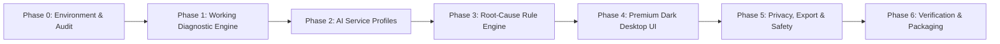

# AI ACCESS DOCTOR — Master Implementation Plan

This document outlines the step-by-step technical implementation, validation matrix, and milestone roadmap for **AI Access Doctor**.

---

## Roadmap & Milestones

---

## Phase Breakdown

### Phase 0: Environment Audit & Initial Project Scaffolding
- [x] Windows 11 x64 OS and architecture verification.
- [x] Node.js, npm, Rust/Cargo, MSVC Build Tools, and Windows SDK audit.
- [x] Edge WebView2 Runtime verification.
- [x] Proxy and network environment discrepancy detection (System 10809 vs Env 53200).
- [x] Reference repositories cloned and audited for licensing (GPL isolation guaranteed).
- [x] `ARCHITECTURE.md` and `IMPLEMENTATION_PLAN.md` generated.
- [ ] Initialize Tauri 2 project with React, TypeScript, and Vite in `c:\AI Access Doctor`.
- [ ] Configure Tailwind CSS, CSS variables, Lucide icons, and modern dark theme typography.

### Phase 1: Working Diagnostic Engine (Rust Core)
Implement modular Rust subsystems under `src-tauri/src/diag/`:
1. **Network Probe (`network.rs`)**:
   - Enumerate active network interfaces via Windows IP Helper (`GetAdaptersAddresses` / `netsh`).
   - Extract IPv4, IPv6, subnet masks, gateway IPs, interface operational status, interface metrics.
   - Dual-stack IPv4/IPv6 ping and socket connect tests.
   - Non-blocking TCP connection latency benchmark.
2. **DNS Probe (`dns.rs`)**:
   - Query system resolver for target hostnames.
   - Multi-resolver comparison: Cloudflare (`1.1.1.1`), Google (`8.8.8.8`), Quad9 (`9.9.9.9`), OpenDNS (`208.67.222.222`).
   - Latency measurement per resolver and inconsistency detection (e.g., DNS poisoning or ISP filtering).
3. **TLS Probe (`tls.rs`)**:
   - Perform direct TLS 1.2 / 1.3 handshake with SNI.
   - Negotiate ALPN protocols (`h2`, `http/1.1`).
   - Validate certificate chain against WebPKI roots vs. native Windows certificate store.
   - Detect self-signed, corporate inspection, or antivirus MITM certificates (e.g., Kaspersky, Zscaler).
4. **Proxy Probe (`proxy.rs`)**:
   - WinINet registry inspection (`HKCU\Software\Microsoft\Windows\CurrentVersion\Internet Settings`): `ProxyEnable`, `ProxyServer`, `AutoConfigURL`.
   - WinHTTP proxy configuration query.
   - Process & system environment variables: `HTTP_PROXY`, `HTTPS_PROXY`, `ALL_PROXY`, `NO_PROXY`.
   - Socket availability & HTTP CONNECT handshake test on detected proxy ports.
5. **VPN Probe (`vpn.rs`)**:
   - Enumerate TAP, TUN, Wintun, WireGuard, Tailscale, Cloudflare WARP adapters.
   - Detect routing table overrides and metric conflicts.

### Phase 2: AI Service Profiles
Implement targeted probes in `src-tauri/src/services/`:
1. **Google Antigravity**:
   - `accounts.google.com` (SSO & token auth reachability)
   - `cloudcode.googleapis.com` (developer APIs)
   - `developerconnect.googleapis.com`
2. **Google Gemini**:
   - `generativelanguage.googleapis.com` (REST & gRPC endpoints)
   - `aiplatform.googleapis.com` (Vertex AI)
3. **OpenAI / Codex**:
   - `api.openai.com`
   - `auth.openai.com`
   - `chatgpt.com`
4. **Anthropic Claude**:
   - `api.anthropic.com`
   - `claude.ai`
5. **GitHub Developer Services**:
   - `api.github.com`
   - `github.com`
   - `copilot-proxy.githubusercontent.com`
- Status differentiation:
  - `DNS_FAILURE`: Host name resolution error.
  - `TCP_TIMEOUT`: Connection timed out or SYN dropped.
  - `TLS_CERT_ERROR`: Handshake failure or invalid certificate chain.
  - `HTTP_REACHABLE_AUTH_REQUIRED`: 401 Unauthorized / 403 Forbidden with normal JSON payload (valid network path, user credentials needed).
  - `RATE_LIMITED`: 429 Too Many Requests.
  - `SERVER_ERROR`: 500 / 502 / 503 / 504.
  - `GEO_BLOCKED`: 403 / 451 with geo-block error indicators.

### Phase 3: Deterministic Root-Cause Rule Engine
Implement rule evaluation in `src-tauri/src/engine/`:
- Cross-correlate probe results to produce definitive diagnostic verdicts:
  - **Verdict Type**: Pass, Warning, Fail, Unknown.
  - **Root Cause Code**: e.g., `PROXY_DEAD_PORT`, `PROXY_ENV_CONFLICT`, `DNS_POISONING`, `ANTIVIRUS_MITM_TLS`, `CORP_FIREWALL_BLOCK`, `IPV6_BLACKHOLE`, `AUTH_CREDENTIALS_MISSING`.
  - **Confidence Level**: High (100%), Medium (75%), Low (50%), Unknown (0%).
  - **Actionable Remediation**: Concrete, step-by-step guidance in clear Russian and English.
  - **Technical Evidence**: Detailed packet/socket/HTTP transcript for senior developer review.

### Phase 4: Premium Dark Desktop UI
Implement modern, responsive UI in `src/`:
1. **Sidebar Navigation**:
   - Dashboard & One-Click Diagnosis
   - AI Services Status
   - Network & Proxy Inspection
   - VPN & Routing
   - Error Analysis & Troubleshooting
   - History & Reports
   - Settings
2. **Dashboard & One-Click Diagnosis**:
   - Large prominent primary action button: **"Начать диагностику"**
   - Real-time progress bar with live test stage display (DNS -> TCP -> TLS -> Proxy -> Services)
   - Diagnostic Summary Cards with status indicators (Passed, Warning, Failed, Unknown)
   - Primary Root-Cause Alert Box with confidence score and recommended fix
3. **Service Profiles View**:
   - Card grid for Antigravity, Gemini, OpenAI, Claude, GitHub
   - Real-time latency, HTTP status code, TLS cipher, and resolution path per service
4. **Network & Proxy View**:
   - Visual comparison: Environment Proxy (`HTTP_PROXY`) vs. Windows User Proxy vs. WinHTTP
   - Active adapter table with IP, Gateway, DNS, and interface speed
5. **VPN & Routing View**:
   - Virtual adapter detection list with status badges
   - Route priority table

### Phase 5: Privacy, History & Sanitized Export
- **SQLite History**:
  - Automatically store run timestamp, target services, diagnostic findings, and latency metrics in local SQLite database (`rusqlite`).
  - History viewer with search, filter, and comparison.
- **Sanitized Export**:
  - Export diagnostic reports as JSON or Markdown.
  - Automatic scrubbing of username, user home paths, private IP addresses (configurable), and proxy credentials.

### Phase 6: Automated Testing & Packaging
- Rust Unit Tests (`cargo test`):
  - Mock network conditions: DNS failure, TCP connection refused, HTTP 401/403/429/500, TLS certificate mismatch, Proxy dead port.
- UI Component Tests & Build Verification:
  - TypeScript type check (`tsc --noEmit`).
  - Vite production build (`npm run build`).
  - Tauri build (`cargo tauri build` or Windows desktop binary generation).
- Production Deliverables:
  - Executable application
  - User documentation & README
  - Known limitations document
