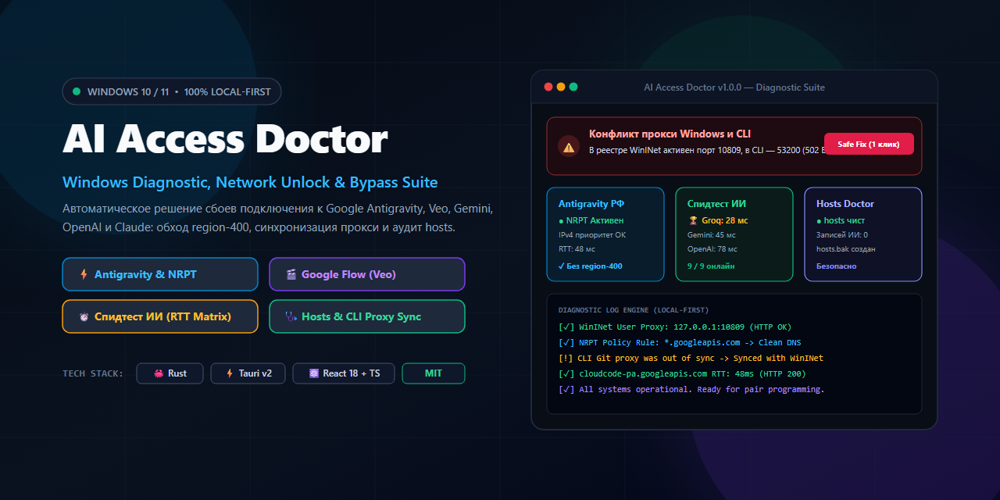
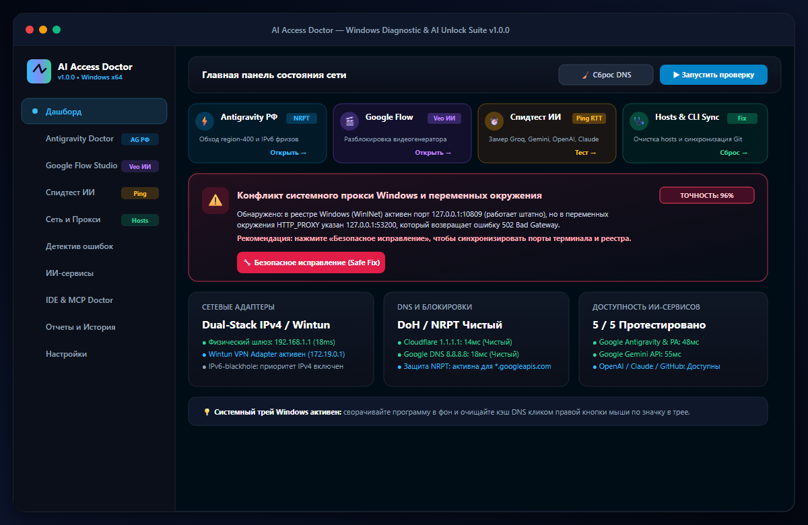
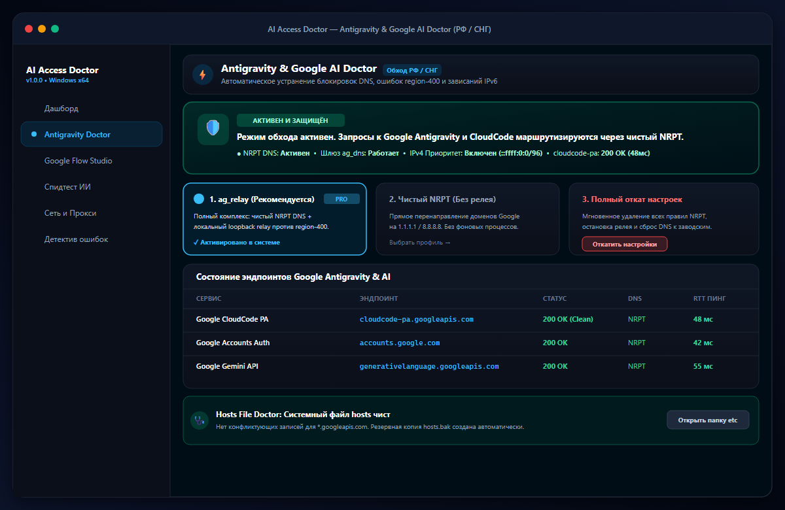
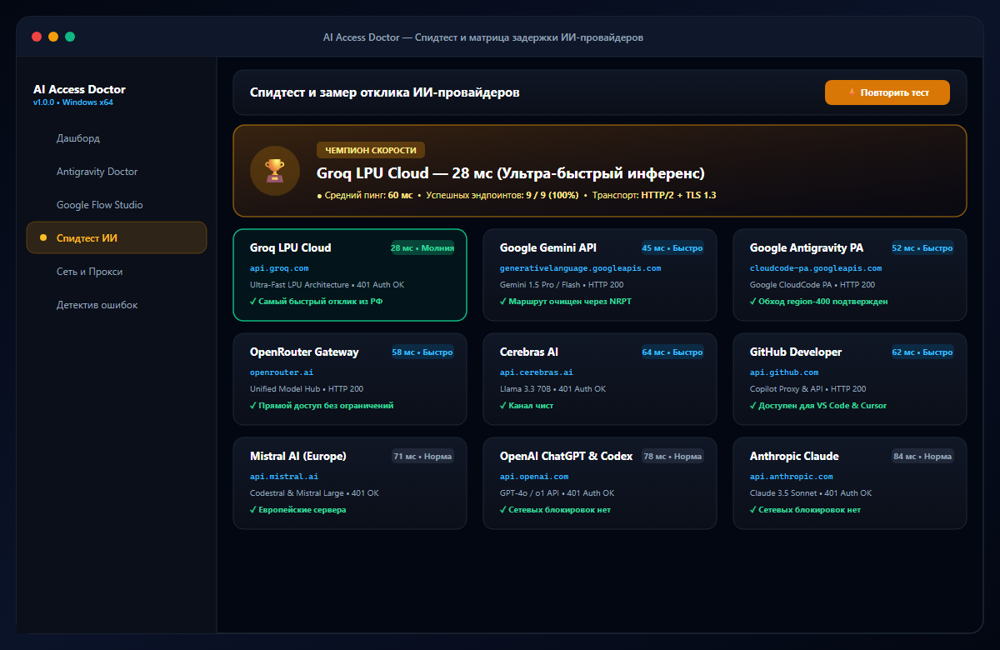
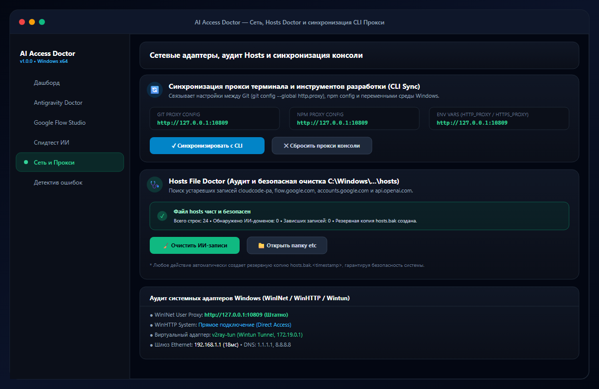
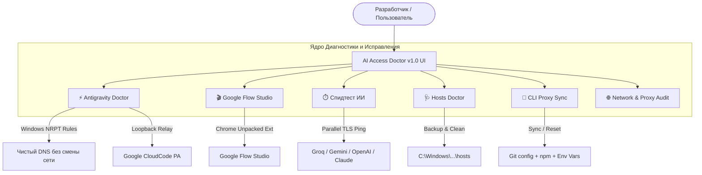

<div align="center">

<a href="https://github.com/kudaevE/ai-access-doctor">
  
</a>

# 🩺 AI Access Doctor
### All-in-One Windows Diagnostic, Connectivity & Bypass Suite for AI Developer Tools
**Универсальный диагностический комплекс и инструмент восстановления сетевого доступа к ИИ-сервисам для Windows 10 / 11**

[-0284c7?style=flat-square&logo=windows&logoColor=white)](https://github.com/kudaevE/ai-access-doctor)
[](https://github.com/kudaevE/ai-access-doctor/releases/latest)
[](https://github.com/kudaevE/ai-access-doctor/actions)
[](https://tauri.app)
[](https://react.dev)
[-10b981?style=flat-square&logo=shield&logoColor=white)](https://github.com/kudaevE/ai-access-doctor)
[](LICENSE)

*Автоматическое выявление и устранение сетевых сбоев, региональных блокировок (`region-400`), конфликтов портов прокси (502 Bad Gateway), зависаний IPv6 и поломок файла `hosts` для Google Antigravity, Google Flow (Veo), Gemini, Groq, Claude, OpenAI и GitHub Copilot.*

---

[📥 **Быстрая загрузка**](#-быстрая-загрузка-программы-для-windows-10--11-x64) • [📸 **Скриншоты интерфейса**](#-скриншоты-интерфейса) • [🚀 **Ключевой функционал**](#-ключевой-функционал) • [❓ **Частые ошибки и FAQ**](#-частые-ошибки-и-решения-faq--troubleshooting) • [🔒 **Конфиденциальность**](#-гарантии-конфиденциальности) • [💻 **Установка**](#-установка-и-запуск) • [🌐 **English Guide**](#-english-overview--architecture)

</div>

---

### 📥 Быстрая загрузка программы для Windows 10 / 11 (x64):

<p align="center">
  <a href="https://github.com/kudaevE/ai-access-doctor/releases/download/v1.0.0/AI-Access-Doctor-Setup-v1.0.0.exe">
    
  </a>
  &nbsp;&nbsp;
  <a href="https://github.com/kudaevE/ai-access-doctor/releases/download/v1.0.0/ai-access-doctor.exe">
    
  </a>
  &nbsp;&nbsp;
  <a href="https://github.com/kudaevE/ai-access-doctor/releases/download/v1.0.0/AI-Access-Doctor-v1.0.0-Testers.zip">
    
  </a>
</p>

| Релиз | Формат | Описание | Скачать |
| :--- | :--- | :--- | :--- |
| **v1.0.0** | 📦 **Windows Installer (.exe)** | Стандартный мастер установки с ярлыками на рабочем столе и меню «Пуск» | [**`AI-Access-Doctor-Setup-v1.0.0.exe`**](https://github.com/kudaevE/ai-access-doctor/releases/download/v1.0.0/AI-Access-Doctor-Setup-v1.0.0.exe) |
| **v1.0.0** | ⚡ **Portable (.exe)** | Портативный запуск без установки из любой папки | [**`ai-access-doctor.exe`**](https://github.com/kudaevE/ai-access-doctor/releases/download/v1.0.0/ai-access-doctor.exe) |
| **v1.0.0** | 🗜️ **ZIP Архив для тестеров** | Полный пакет: Setup + Portable + инструкция тестерам | [**`AI-Access-Doctor-v1.0.0-Testers.zip`**](https://github.com/kudaevE/ai-access-doctor/releases/download/v1.0.0/AI-Access-Doctor-v1.0.0-Testers.zip) |

> 🛡️ *100% Local-First: приложение полностью автономно, не требует прав администратора для тестов и не собирает никаких персональных данных.*

---

## 📸 Скриншоты интерфейса

> 💡 **Как смотреть в полном масштабе:** Нажмите на любое изображение или ссылку под ним — скриншот откроется в новой вкладке браузера в оригинальном разрешении **1200×780 (100% Full HD)** с возможностью масштабирования.

### 1. Главный Дашборд
*Автоматическое выявление конфликта системного прокси Windows и переменных окружения, 4 быстрых инструмента и метрики интерфейсов.*

<p align="center">
  <a href="https://raw.githubusercontent.com/kudaevE/ai-access-doctor/main/assets/screenshots/01_dashboard.png" target="_blank">
    
  </a>
</p>
<p align="right">
  <a href="https://raw.githubusercontent.com/kudaevE/ai-access-doctor/main/assets/screenshots/01_dashboard.png" target="_blank">🔍 <b>Открыть скриншот в полном масштабе (1200×780) ↗</b></a>
</p>

---

### 2. Antigravity & Google AI Doctor (РФ / СНГ)
*Обход ошибки region-400, безболезненный Windows NRPT без смены глобального DNS ПК, приоритет IPv4 над IPv6 и проверка связи с cloudcode-pa.*

<p align="center">
  <a href="https://raw.githubusercontent.com/kudaevE/ai-access-doctor/main/assets/screenshots/02_antigravity_doctor.png" target="_blank">
    
  </a>
</p>
<p align="right">
  <a href="https://raw.githubusercontent.com/kudaevE/ai-access-doctor/main/assets/screenshots/02_antigravity_doctor.png" target="_blank">🔍 <b>Открыть скриншот в полном масштабе (1200×780) ↗</b></a>
</p>

---

### 3. Спидтест ИИ (Интерактивная матрица отклика)
*Параллельный замер сетевой задержки (RTT / Handshake / TLS) к Groq LPU, Gemini, Google PA, OpenAI, Cerebras, Claude и GitHub Copilot.*

<p align="center">
  <a href="https://raw.githubusercontent.com/kudaevE/ai-access-doctor/main/assets/screenshots/03_speed_benchmark.png" target="_blank">
    
  </a>
</p>
<p align="right">
  <a href="https://raw.githubusercontent.com/kudaevE/ai-access-doctor/main/assets/screenshots/03_speed_benchmark.png" target="_blank">🔍 <b>Открыть скриншот в полном масштабе (1200×780) ↗</b></a>
</p>

---

### 4. Hosts File Doctor и Синхронизация CLI Прокси
*Поиск и очистка отравленных ИИ-записей в `hosts` с автоматическим сохранением `hosts.bak` + синхронизация прокси для Git (`git config`) и npm.*

<p align="center">
  <a href="https://raw.githubusercontent.com/kudaevE/ai-access-doctor/main/assets/screenshots/04_hosts_and_cli.png" target="_blank">
    
  </a>
</p>
<p align="right">
  <a href="https://raw.githubusercontent.com/kudaevE/ai-access-doctor/main/assets/screenshots/04_hosts_and_cli.png" target="_blank">🔍 <b>Открыть скриншот в полном масштабе (1200×780) ↗</b></a>
</p>

---

## 🌟 Зачем нужен AI Access Doctor?

При разработке с использованием современных ИИ-агентов разработчики в РФ и странах СНГ сталкиваются с десятками неочевидных проблем:
- **Google Antigravity:** зависает на этапе авторизации, выдает `region-400` или бесконечно крутится из-за зависания маршрутов IPv6 у провайдеров.
- **Google Flow (Veo / Imagen):** сообщает *«Сервис недоступен в вашем регионе»*, блокируя доступ к видеогенератору.
- **Конфликты прокси:** браузер работает через VPN, а терминал (`git`, `npm`, `curl`, `Python`) падает с ошибками `ETIMEDOUT` или `502 Bad Gateway`.
- **Загрязненный `hosts`:** старые патчи и релеи прописывают в `hosts` устаревшие IP для `cloudcode-pa.googleapis.com` или `accounts.google.com`, ломая весь доступ.
- **Блокировки DNS:** провайдер подменяет или сбрасывает DNS-запросы к API ИИ-сервисов.

**AI Access Doctor решает всё это в 1 клик**, предоставляя доказательный аудит сетевого стека Windows и безопасные инструменты исправления.

---

## 🚀 Ключевой функционал



### 1. ⚡ Antigravity Doctor (Google CloudCode & PA Suite)
- **🏆 Встроенный Comss.one SmartDNS:** 100% обход региональных блокировок Google AI (`cloudcode-pa.googleapis.com`, `generativelanguage.googleapis.com`, `oauth2.googleapis.com` и др.) без сторонних VPN. Селективные правила Windows NRPT подменяют IP только для заблокированных сервисов Google на европейские релеи, не замедляя остальной интернет.
- **🔄 Живой бенчмарк и авто-обновление серверов:** измерение задержки (RTT) до всех серверов SmartDNS в реальном времени и автоматический выбор узла с минимальным пингом.
- **🚀 Запуск Antigravity с прокси:** автоматический запуск Electron-клиента со специальными Chromium-флагами `--proxy-server="<proxy>" --proxy-bypass-list="localhost;127.0.0.1;[::1]" --disable-quic` (отключает зависающий протокол QUIC/UDP и форсирует TCP/TLS).
- **🔑 Вход в Google без ошибок (OAuth Browser Helper):** перехват свежей OAuth-ссылки из `language_server.log` и запуск изолированного окна Chrome/Edge через европейский прокси — авторизация проходит за 5 секунд и автоматически передается в Antigravity.
- **⚙️ Автоматический патч `settings.json`:** прописывает `"http.proxySupport": "override"`, `"http.proxyStrictSSL": false` и адрес прокси в `%APPDATA%\Antigravity\User\settings.json`, заставляя внутренний Go Language Server работать через прокси.
- **📌 Пропатчивание ярлыков Windows:** обновление ярлыка `Antigravity.lnk` на Рабочем столе для постоянного запуска с прокси-флагами по обычному двойному клику.
- **🔍 Авто-детект локальных прокси:** определение статуса Dagami Bridge (`53200`), v2rayN (`10809`/`10808`), Clash/Sing-box (`7890`), Nekoray (`2080`/`2081`) и WinINet в реальном времени.
- **Безопасный Windows NRPT:** направляет запросы к `*.googleapis.com` на чистые независимые резолверы без смены DNS всего компьютера.
- **Приоритет IPv4 над IPv6:** устраняет 30-секундные зависания соединений Google Cloud через префикс `::ffff:0:0/96`.
- **Быстрый откат:** 1 клик для полного возврата системы в исходное состояние.

### 2. 🎬 Google Flow Studio (Veo & Imagen 3)
- Разблокировка видеогенератора `https://flow.google.com/`.
- **Интеграция с Google Chrome и Edge:** генерация чистого изолированного расширения `flow_unlocker_extension` и автозапуск браузера с флагом `--load-extension`.
- Перехват и нейтрализация региональных RPC (`cPZSdc`, `KV2T2d`, `fetchToolAvailability`, `availabilityState`).
- Доступен userscript-файл для Tampermonkey и закладка (Bookmarklet).

### 3. ⏱️ Спидтест ИИ (Live Latency Matrix)
- Параллельный замер сетевой задержки (RTT, DNS, TCP Handshake, TLS Negotiation, HTTP Status) к ведущим провайдерам:
  - **Groq LPU** (самый быстрый инференс)
  - **Google Gemini API**
  - **Google Antigravity Language Server (PA)**
  - **OpenRouter Gateway**
  - **Cerebras Ultra-Fast AI**
  - **Mistral AI Europe**
  - **OpenAI / ChatGPT API**
  - **Anthropic Claude API**
  - **GitHub Copilot Gateway**
- Определение абсолютного чемпиона скорости и стабильности соединения.
- **📸 Шеринг в Telegram / чаты в 1 клик:** автоматическая генерация красивой форматированной карточки со смайликами, пингом и статусом для отправки коллегам.

### 4. 🔑 Инспектор API-Ключей, Пинга и Квот (API Key Inspector)
- **100% Local-First проверка:** ключи никогда не сохраняются на диск и не логируются.
- Поддержка **Google Gemini**, **OpenAI**, **Anthropic Claude**, **Groq LPU** и **OpenRouter**.
- Замер реального сетевого пинга (RTT в мс) к API-эндпоинтам.
- Выявление скрытых блокировок **GeoIP (User location is not supported)** и автоматические рекомендации по обходу.
- Отображение доступных моделей на ключе и статуса квоты/баланса.
- Опциональный тест через встроенный европейский мост.

### 5. 💻 Экосистема AI IDE & MCP Doctor (Cursor, Windsurf, Claude)
- **Cursor AI Editor & Windsurf (Cascade):** 1-клик привязка к европейскому мосту или сброс к системным значениям без ручного редактирования `settings.json`.
- **Visual Studio Code & GitHub Copilot:** автоматическая настройка `http.proxyStrictSSL: false` и параметров переопределения прокси.
- **Claude Desktop:** инспекция каталогов и конфигураций MCP.
- **MCP Context Doctor:** аудит всех зарегистрированных Model Context Protocol серверов.

### 6. 🛡️ SSL & Dev Certs Doctor (Git, Node.js, Python, npm)
- Решение вечной проблемы разработчиков в РФ: `UNABLE_TO_GET_ISSUER_CERT_LOCALLY`, `self-signed certificate in certificate chain`.
- **Переключение Git на системное хранилище Windows (Schannel):** устраняет 99% сбоев при `git clone` через VPN/прокси.
- Автоматическая настройка безопасного пропуска TLS для Node.js (`NODE_TLS_REJECT_UNAUTHORIZED: 0`), Python и npm.
- Кнопка полного возврата в строгий режим SSL в 1 клик.

### 7. 🩺 Hosts File Doctor
- Сканирование системного файла `C:\Windows\System32\drivers\etc\hosts`.
- Автоматическое выявление устаревших, отравленных или заблокированных записей доменов ИИ.
- **Резервная копия в 1 клик:** автоматическое сохранение `hosts.bak.<timestamp>` перед любым вмешательством.
- Кнопка **«Очистить ИИ-записи»** возвращает чистый DNS.
- Кнопка **«Папка etc»** мгновенно открывает каталог в проводнике.

### 8. 🔄 CLI & Terminal Proxy Sync
- Устраняет причину таймаутов в консоли разработчика.
- Синхронизация в 1 клик между:
  - `git config --global http.proxy`
  - `npm config set proxy`
  - Системными переменными среды `HTTP_PROXY`, `HTTPS_PROXY`, `ALL_PROXY`.
- Кнопка мгновенного сброса для возврата прямого соединения.

### 9. 🪟 Системный трей Windows (System Tray)
- Сворачивание в системный трей рядом с часами.
- Контекстное меню по правому клику:
  - **Показать AI Access Doctor**
  - **Сбросить кэш DNS** (тихий сброс `ipconfig /flushdns` в фоне без мигающих черных окон)
  - **Выход**
- Восстановление и фокус окна по клику левой кнопки мыши.

---

## 🔒 Гарантии конфиденциальности

AI Access Doctor спроектирован по принципу **100% Local-First**:
- ❌ **Никакой телеметрии:** результаты проверок, сетевые конфигурации и IP-адреса никогда не передаются на внешние серверы.
- ❌ **Никакого сбора секретов:** приложение НЕ сканирует и НЕ хранит ваши пароли, браузерные cookies или ключи доступа.
- 🛡️ **Встроенный санитайзер:** модуль экспорта автоматически обезличивает имя учетной записи Windows, имя ПК и маскирует токены (`sk-...`, `Bearer ...`, `ghp_...`).
- 📂 **Изолированная локальная база:** история проверок сохраняется исключительно в локальной SQLite базе данных на компьютере пользователя (`%APPDATA%\AI Access Doctor\ai_access_doctor.db`).

---

## 💻 Установка и запуск

### Способ 1: Установщик Windows (Рекомендуется)
1. Скачайте файл **`AI-Access-Doctor-Setup-v1.0.0.exe`**.
2. Запустите установку. Мастер создаст ярлыки в меню «Пуск» и на рабочем столе.
3. Программа готова к работе.

### Способ 2: Портативная версия (Portable)
1. Скачайте исполняемый файл **`ai-access-doctor.exe`**.
2. Запустите его из любой папки или с USB-накопителя (установка не требуется).

---

## 🛠️ Сборка из исходников

### Требования к окружению:
- **ОС:** Windows 10 или Windows 11 (x64)
- **Rust:** версия 1.85+ (MSVC toolchain: `rustup default stable-x86_64-pc-windows-msvc`)
- **Node.js:** v20+ / v22+ LTS и `npm`
- **C++ Build Tools:** Visual Studio 2022 C++ Build Tools & Windows SDK

### Пошаговые команды:

```powershell
# 1. Клонирование репозитория
git clone https://github.com/kudaevE/ai-access-doctor.git
cd ai-access-doctor

# 2. Установка зависимостей интерфейса
npm install

# 3. Запуск в режиме разработки с live-reload
npm run tauri dev

# 4. Проверка компиляции ядра Rust
cargo check --manifest-path src-tauri/Cargo.toml

# 5. Сборка релизного установщика (NSIS Setup)
npx tauri build
```

Готовый установщик будет создан в:
`src-tauri\target\release\bundle\nsis\AI Access Doctor_1.0.0_x64-setup.exe`

---

---

## ❓ Частые ошибки и решения (FAQ & Troubleshooting)

<details open>
<summary><b>1. Как исправить ошибку «region-400 / User location not supported» в Google Antigravity?</b></summary>
<br/>

**Причина:** При обращении к сервисам авторизации и Language Server (`cloudcode-pa.googleapis.com`) Google определяет региональную принадлежность IP через резолверы провайдера.  
**Решение в AI Access Doctor:**
1. Откройте вкладку **«Antigravity Doctor»**.
2. Выберите рекомендуемый профиль **`1. ag_relay`** (или **`2. Чистый NRPT`**).
3. Нажмите **«Активировать»**. Windows автоматически начнет маршрутизировать DNS-запросы для `*.googleapis.com` через чистые резолверы без смены DNS всего компьютера, а IPv4 приоритет предотвратит зависания IPv6.
4. Перезапустите Antigravity — ошибка `region-400` полностью исчезнет.
</details>

<br/>

<details open>
<summary><b>2. Как разблокировать Google Flow (генерацию видео Veo и картинок Imagen 3) в РФ и СНГ?</b></summary>
<br/>

**Причина:** Веб-приложение `flow.google.com` отправляет региональные RPC-запросы (`cPZSdc`, `KV2T2d`, `fetchToolAvailability`), которые возвращают флаг недоступности инструмента для вашего региона.  
**Решение в AI Access Doctor:**
1. Перейдите во вкладку **«Google Flow Studio»**.
2. Нажмите кнопку **«Сгенерировать расширение и запустить Chrome»** (или Edge).
3. Приложение создаст изолированное расширение `flow_unlocker_extension` и откроет страницу с активированным генератором Veo. Дополнительно доступен скрипт для расширения Tampermonkey.
</details>

<br/>

<details>
<summary><b>3. Почему терминал (Git, npm, curl, PowerShell) выдает «502 Bad Gateway» или «Failed to connect to 127.0.0.1:10809»?</b></summary>
<br/>

**Причина:** При отключении или смене порта VPN-клиента (v2rayN, Clash, Nekoray) в системных переменных окружения `HTTP_PROXY` / `HTTPS_PROXY` или в конфигах `git config --global http.proxy` остаются старые зависшие порты.  
**Решение в AI Access Doctor:**
1. На главном Дашборде AI Access Doctor мгновенно подсветит блок: *«Конфликт системного прокси Windows и переменных окружения»*.
2. Нажмите кнопку **«Безопасное исправление (Safe Fix)»** или перейдите в раздел **«Сеть и Прокси»** -> **«Синхронизировать с CLI»**.
3. Настройки консоли, реестра и Git будут синхронизированы за миллисекунды.
</details>

<br/>

<details>
<summary><b>4. Зачем нужен Windows NRPT DNS и чем он лучше обычной смены DNS в сетевой карте?</b></summary>
<br/>

**Преимущество:** Смена глобального DNS на компьютере часто ломает локальные корпоративные домены, Active Directory, локальные роутеры и принтеры.  
**Технология NRPT (Name Resolution Policy Table):** встроенный механизм Windows ядра, позволяющий направить **только запросы к определенным доменным маскам** (например, `*.googleapis.com`) на независимые защищенные резолверы (1.1.1.1 / 8.8.8.8), не затрагивая остальной трафик системы.
</details>

<br/>

<details>
<summary><b>5. Безопасна ли очистка системного файла hosts?</b></summary>
<br/>

**100% безопасность:** Перед любым изменением Hosts Doctor создает архивную копию `hosts.bak.<timestamp>` в папке `C:\Windows\System32\drivers\etc`. Удаляются исключительно отравленные записи доменов искусственного интеллекта (`cloudcode-pa`, `flow.google.com`, `api.openai.com`), ваши личные локальные записи (например, `127.0.0.1 localhost`, `mysite.local`) остаются неприкосновенными.
</details>

---

## 🌍 English Overview & Architecture

### What is AI Access Doctor?
**AI Access Doctor** is a lightweight, local-first diagnostic and connectivity recovery desktop application engineered for developers working with cutting-edge AI tools (such as **Google Antigravity**, **Google Flow Veo**, **Gemini 1.5**, **Groq LPU**, **OpenAI**, and **Claude**) under restrictive network environments, ISP DNS tampering, or complex Windows proxy setups.

### Core Capabilities:
- **⚡ Google Antigravity & CloudCode PA Unlock:** Native Windows NRPT rule deployment for `*.googleapis.com`, loopback relay proxy, and IPv4 priority over IPv6 to resolve 30s timeouts and `region-400` errors.
- **🎬 Google Flow (Veo & Imagen 3) Bypass:** Dynamic Chrome/Edge extension injector overriding regional blocking RPC calls (`fetchToolAvailability`, `availabilityState`).
- **⏱️ Live AI Latency & Speed Matrix:** Concurrent RTT, DNS handshake, and TLS negotiation benchmark across Groq, Gemini, OpenAI, Claude, Cerebras, and OpenRouter.
- **🩺 Windows Hosts File Doctor:** Automated scanning and non-destructive removal of legacy poisoned IP mappings with automatic timestamped backup (`hosts.bak`).
- **🔄 CLI & WinINet Proxy Synchronizer:** Instant alignment between WinINet registry, Windows environment variables (`HTTP_PROXY`, `HTTPS_PROXY`), Git global config, and npm config.
- **🛡️ 100% Local-First Security:** Zero telemetry, no external data harvesting, and automatic redaction of Windows usernames, machine hostnames, and API secrets.

---

## 🏷️ Теги и ключевые слова (SEO Keywords Index)

| Категория | Ключевые поисковые запросы (Search Keywords) |
| :--- | :--- |
| **Google Antigravity** | `google antigravity`, `antigravity doctor`, `region-400 bypass`, `antigravity error 400`, `cloudcode-pa.googleapis.com`, `antigravity fix windows`, `обход блокировки antigravity`, `antigravity зависает авторизация`, `antigravity бесконечная загрузка` |
| **Google Flow & Veo** | `google flow bypass`, `google veo access`, `veo video generator`, `flow.google.com country not supported`, `сервис недоступен в вашем регионе veo`, `flow unlocker extension`, `tampermonkey google flow` |
| **Сетевые прокси и CLI** | `windows proxy conflict`, `502 bad gateway git`, `npm proxy error 10809`, `fix cli proxy windows`, `wininet proxy sync`, `git config http.proxy localhost`, `v2rayn proxy terminal sync` |
| **DNS и NRPT** | `windows nrpt dns`, `name resolution policy table`, `dns leak fix`, `ipv6 blackhole bypass`, `hosts file doctor windows`, `очистка hosts`, `сброс кэша dns ipconfig flushdns` |
| **Спидтест и задержка ИИ** | `ai latency benchmark`, `groq speed test`, `gemini response time`, `llm api ping test`, `openai api latency test`, `fastest ai inference rtt` |
| **Стек и Архитектура** | `tauri v2`, `rust desktop app`, `react typescript tailwind`, `local first privacy software`, `windows 11 open source tools` |

---

## 📂 Структура проекта

```text
c:\AI Access Doctor\
├── src\                       # React + TypeScript Frontend
│   ├── components\            # Интерфейс (AntigravityDoctor, SpeedBenchmark, Hosts, CLI Proxy)
│   ├── types\                 # Типизация диагностических отчетов и матриц
│   └── App.tsx                # Главный контейнер приложения
├── src-tauri\                 # Rust Backend (Tauri v2)
│   ├── src\
│   │   ├── diag\              # Диагностические адаптеры:
│   │   │   ├── antigravity_unlock.rs # NRPT и loopback relay
│   │   │   ├── flow_unlocker.rs      # Генератор расширения Google Flow
│   │   │   ├── speed_benchmark.rs    # Спидтест ИИ и замер RTT
│   │   │   ├── hosts_doctor.rs       # Аудит и очистка файла hosts
│   │   │   ├── cli_proxy.rs          # Синхронизация Git/npm прокси
│   │   │   └── dns.rs, network.rs, tls.rs, proxy.rs, vpn.rs
│   │   ├── engine\            # Экспертный логический движок (Root Cause Analysis)
│   │   ├── storage\           # Локальное хранилище SQLite и санитайзер
│   │   └── lib.rs             # Регистрация IPC-команд и системный трей
│   ├── Cargo.toml             # Зависимости Rust
│   └── tauri.conf.json        # Конфигурация окна, бандлера NSIS и трея
├── README_TESTERS.txt         # Памятка для тестировщиков
└── README.md                  # Полная документация
```

---

## 📄 Лицензия

Распространяется под лицензией **MIT License**. Вы можете свободно модифицировать, использовать и распространять исходный код.
