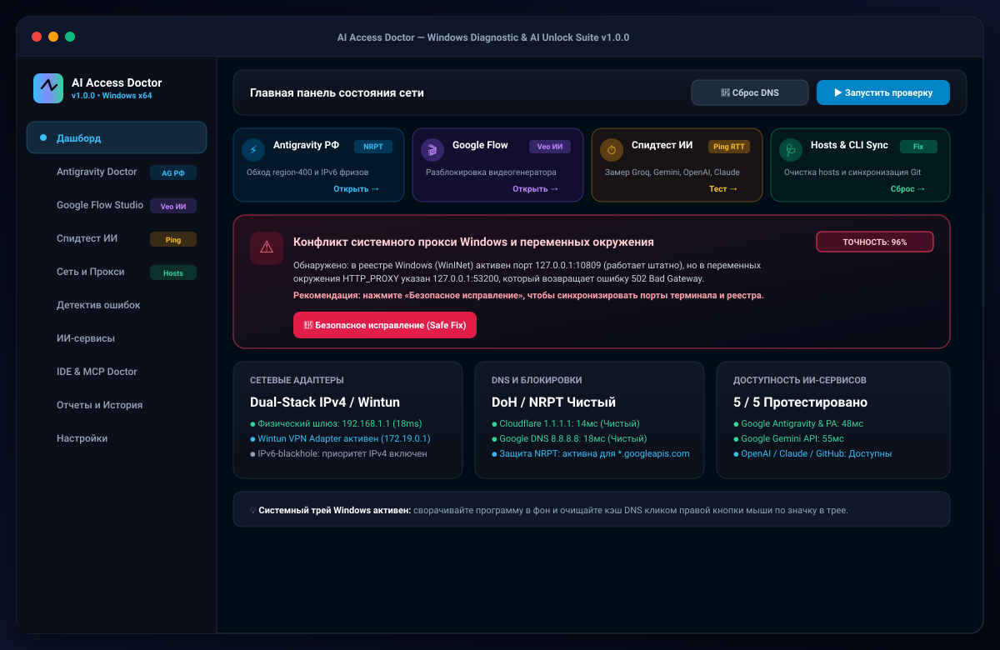
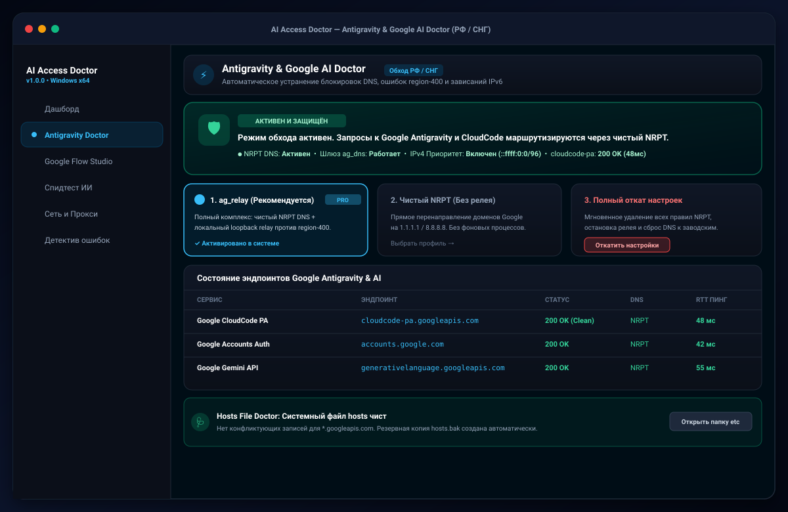
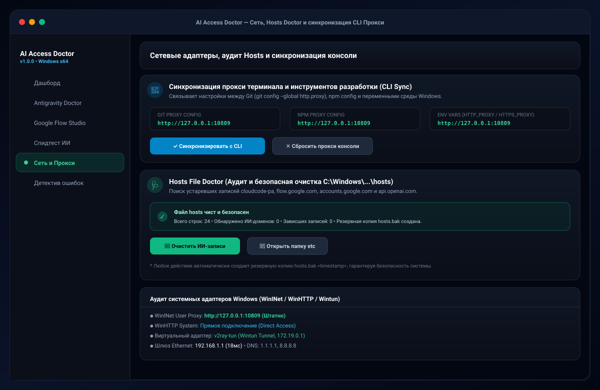

<div align="center">

# 🩺 AI Access Doctor
### All-in-One Windows Diagnostic, Connectivity & Bypass Suite for AI Developer Tools

[-blue?logo=windows)](https://github.com)
[](https://tauri.app)
[](https://react.dev)
[-emerald?logo=shield)](https://github.com)
[](LICENSE)

*Автоматическое выявление и устранение сбоев подключения, региональных блокировок (`region-400`), конфликтов прокси и поломок `hosts` для Google Antigravity, Google Flow (Veo), Gemini, OpenAI, Claude и GitHub Copilot.*

[**Скачать Setup (.exe)**](#-быстрая-загрузка-direct-downloads) • [**Скриншоты**](#-скриншоты-интерфейса) • [**Возможности**](#-ключевой-функционал) • [**Конфиденциальность**](#-гарантии-конфиденциальности) • [**Сборка**](#-сборка-из-исходников)

</div>

---

### 📥 Быстрая загрузка (Direct Downloads):

| Релиз | Формат | Описание | Скачать |
| :--- | :--- | :--- | :--- |
| **v1.0.0** | 📦 **Windows Installer (.exe)** | Стандартный мастер установки с ярлыками на рабочем столе и меню «Пуск» | [**Скачать Setup.exe**](https://github.com/kudaevE/ai-access-doctor/releases/download/v1.0.0/AI-Access-Doctor-Setup-v1.0.0.exe) |
| **v1.0.0** | ⚡ **Portable (.exe)** | Портативный запуск без установки из любой папки | [**Скачать Portable.exe**](https://github.com/kudaevE/ai-access-doctor/releases/download/v1.0.0/ai-access-doctor.exe) |
| **v1.0.0** | 🗜️ **ZIP Архив для тестеров** | Полный пакет: Setup + Portable + инструкция тестерам | [**Скачать Testers.zip**](https://github.com/kudaevE/ai-access-doctor/releases/download/v1.0.0/AI-Access-Doctor-v1.0.0-Testers.zip) |

> 🛡️ *100% Local-First: приложение полностью безопасно, автономно и не собирает никаких персональных данных.*

---

## 📸 Скриншоты интерфейса

<details open>
<summary><b>1. Главный Дашборд (Обнаружение конфликта прокси и экспресс-доступ)</b></summary>
<br/>


</details>

<br/>

<details open>
<summary><b>2. Antigravity Doctor (Обход блокировок РФ/СНГ, NRPT и IPv4 приоритет)</b></summary>
<br/>


</details>

<br/>

<details open>
<summary><b>3. Спидтест ИИ (Интерактивная матрица отклика Groq, Gemini, PA, OpenAI, Claude)</b></summary>
<br/>


</details>

<br/>

<details open>
<summary><b>4. Hosts File Doctor и Синхронизация CLI Прокси (Git & npm)</b></summary>
<br/>


</details>

---

## 🌟 Зачем нужен AI Access Doctor?

При разработке с использованием современных ИИ-агентов разработчики в РФ и странах СНГ сталкиваются с десятками неочевидных проблем:
- **Google Antigravity:** зависает на этапе авторизации, выдает `region-400` или бесконечно крутится из-за зависания маршрутов IPv6 у провайдеров.
- **Google Flow (Veo / Imagen):** сообщает *«Сервис недоступен в вашем регионе»*, блокируя доступ к видеогенератору.
- **Конфликты прокси:** браузер работает через VPN, а терминал (`git`, `npm`, `curl`, `Python`) падает с ошибками `ETIMEDOUT` или `502 Bad Gateway`.
- **Загрязненный `hosts`:** старые патчи и релеи прописывают в `hosts` устаревшие IP для `cloudcode-pa.googleapis.com` или `accounts.google.com`, ломая весь доступ.
- **Блокировки DNS:** провайдер подменяет или сбрасывает DNS-запросы к API ИИ-сервисов.

**AI Access Doctor решает всё это в 1 клик**, предоставляя доказательный аудит сетевого стека Windows и безопасные инструменты исправления.

---

## 🚀 Ключевой функционал


### 1. ⚡ Antigravity Doctor (Google CloudCode & PA)
- **Безопасный Windows NRPT:** направляет исключительно запросы к `*.googleapis.com` на чистые независимые резолверы без смены DNS всего компьютера.
- **Приоритет IPv4 над IPv6:** устраняет 30-секундные зависания соединений Google Cloud через префикс `::ffff:0:0/96`.
- **Локальный шлюз (ag_dns loopback):** изолированный прокси для устранения ошибок `region-400` в Language Server.
- **Быстрый откат:** 1 клик для полного возврата системы в исходное состояние.

### 2. 🎬 Google Flow Studio (Veo & Imagen 3)
- Разблокировка видеогенератора `https://flow.google.com/`.
- **Интеграция с Google Chrome и Edge:** генерация чистого изолированного расширения `flow_unlocker_extension` и автозапуск браузера с флагом `--load-extension`.
- Перехват и нейтрализация региональных RPC (`cPZSdc`, `KV2T2d`, `fetchToolAvailability`, `availabilityState`).
- Доступен userscript-файл для Tampermonkey и закладка (Bookmarklet).

### 3. ⏱️ Спидтест ИИ (Live Latency Matrix)
- Параллельный замер сетевой задержки (RTT, DNS, TCP Handshake, TLS Negotiation, HTTP Status) к ведущим провайдерам:
  - **Groq LPU** (самый быстрый инференс)
  - **Google Gemini API**
  - **Google Antigravity Language Server (PA)**
  - **OpenRouter Gateway**
  - **Cerebras Ultra-Fast AI**
  - **Mistral AI Europe**
  - **OpenAI / ChatGPT API**
  - **Anthropic Claude API**
  - **GitHub Copilot Gateway**
- Определение абсолютного чемпиона скорости и стабильности соединения.

### 4. 🩺 Hosts File Doctor
- Сканирование системного файла `C:\Windows\System32\drivers\etc\hosts`.
- Автоматическое выявление устаревших, отравленных или заблокированных записей доменов ИИ.
- **Резервная копия в 1 клик:** автоматическое сохранение `hosts.bak.<timestamp>` перед любым вмешательством.
- Кнопка **«Очистить ИИ-записи»** возвращает чистый DNS.
- Кнопка **«Папка etc»** мгновенно открывает каталог в проводнике.

### 5. 🔄 CLI & Terminal Proxy Sync
- Устраняет причину таймаутов в консоли разработчика.
- Синхронизация в 1 клик между:
  - `git config --global http.proxy`
  - `npm config set proxy`
  - Системными переменными среды `HTTP_PROXY`, `HTTPS_PROXY`, `ALL_PROXY`.
- Кнопка мгновенного сброса для возврата прямого соединения.

### 6. 🪟 Системный трей Windows (System Tray)
- Сворачивание в системный трей рядом с часами.
- Контекстное меню по правому клику:
  - **Показать AI Access Doctor**
  - **Сбросить кэш DNS** (тихий сброс `ipconfig /flushdns` в фоне без мигающих черных окон)
  - **Выход**
- Восстановление и фокус окна по клику левой кнопки мыши.

---

## 🔒 Гарантии конфиденциальности

AI Access Doctor спроектирован по принципу **100% Local-First**:
- ❌ **Никакой телеметрии:** результаты проверок, сетевые конфигурации и IP-адреса никогда не передаются на внешние серверы.
- ❌ **Никакого сбора секретов:** приложение НЕ сканирует и НЕ хранит ваши пароли, браузерные cookies или ключи доступа.
- 🛡️ **Встроенный санитайзер:** модуль экспорта автоматически обезличивает имя учетной записи Windows, имя ПК и маскирует токены (`sk-...`, `Bearer ...`, `ghp_...`).
- 📂 **Изолированная локальная база:** история проверок сохраняется исключительно в локальной SQLite базе данных на компьютере пользователя (`%APPDATA%\AI Access Doctor\ai_access_doctor.db`).

---

## 💻 Установка и запуск

### Способ 1: Установщик Windows (Рекомендуется)
1. Скачайте файл **`AI-Access-Doctor-Setup-v1.0.0.exe`**.
2. Запустите установку. Мастер создаст ярлыки в меню «Пуск» и на рабочем столе.
3. Программа готова к работе.

### Способ 2: Портативная версия (Portable)
1. Скачайте исполняемый файл **`ai-access-doctor.exe`**.
2. Запустите его из любой папки или с USB-накопителя (установка не требуется).

---

## 🛠️ Сборка из исходников

### Требования к окружению:
- **ОС:** Windows 10 или Windows 11 (x64)
- **Rust:** версия 1.85+ (MSVC toolchain: `rustup default stable-x86_64-pc-windows-msvc`)
- **Node.js:** v20+ / v22+ LTS и `npm`
- **C++ Build Tools:** Visual Studio 2022 C++ Build Tools & Windows SDK

### Пошаговые команды:

```powershell
# 1. Клонирование репозитория
git clone https://github.com/kudaevE/ai-access-doctor.git
cd ai-access-doctor

# 2. Установка зависимостей интерфейса
npm install

# 3. Запуск в режиме разработки с live-reload
npm run tauri dev

# 4. Проверка компиляции ядра Rust
cargo check --manifest-path src-tauri/Cargo.toml

# 5. Сборка релизного установщика (NSIS Setup)
npx tauri build
```

Готовый установщик будет создан в:
`src-tauri\target\release\bundle\nsis\AI Access Doctor_1.0.0_x64-setup.exe`

---

## 📂 Структура проекта

```text
c:\AI Access Doctor\
├── src\                       # React + TypeScript Frontend
│   ├── components\            # Интерфейс (AntigravityDoctor, SpeedBenchmark, Hosts, CLI Proxy)
│   ├── types\                 # Типизация диагностических отчетов и матриц
│   └── App.tsx                # Главный контейнер приложения
├── src-tauri\                 # Rust Backend (Tauri v2)
│   ├── src\
│   │   ├── diag\              # Диагностические адаптеры:
│   │   │   ├── antigravity_unlock.rs # NRPT и loopback relay
│   │   │   ├── flow_unlocker.rs      # Генератор расширения Google Flow
│   │   │   ├── speed_benchmark.rs    # Спидтест ИИ и замер RTT
│   │   │   ├── hosts_doctor.rs       # Аудит и очистка файла hosts
│   │   │   ├── cli_proxy.rs          # Синхронизация Git/npm прокси
│   │   │   └── dns.rs, network.rs, tls.rs, proxy.rs, vpn.rs
│   │   ├── engine\            # Экспертный логический движок (Root Cause Analysis)
│   │   ├── storage\           # Локальное хранилище SQLite и санитайзер
│   │   └── lib.rs             # Регистрация IPC-команд и системный трей
│   ├── Cargo.toml             # Зависимости Rust
│   └── tauri.conf.json        # Конфигурация окна, бандлера NSIS и трея
├── README_TESTERS.txt         # Памятка для тестировщиков
└── README.md                  # Полная документация
```

---

## 📄 Лицензия

Распространяется под лицензией **MIT License**. Вы можете свободно модифицировать, использовать и распространять исходный код.
